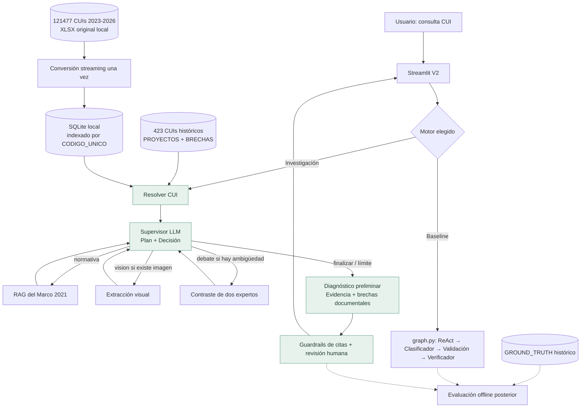

# Arquitectura de solución — Investigador V2

## Vista conceptual

## ¿Por qué no es solamente un workflow?
En V1 siempre se recorren pasos de clasificación, validación y verificación; hay selección de herramientas dentro de ReAct, pero la misión está prefijada. En V2, el **supervisor** produce un plan revisable y elige una acción a partir de la evidencia. No está obligado a usar visión ni especialistas. La ruta depende de las observaciones y los presupuestos disponibles.

**Aclaración esencial:** los bordes de LangGraph siguen predefinidos y las opciones del agente están restringidas. Eso es intencional: la autonomía se sitúa en las elecciones y planes, no en conceder permisos ilimitados. La arquitectura por sí sola no demuestra mejores resultados: se necesita evaluación comparativa.

## Arquitectura de componentes

| Capa | Archivo | Responsabilidad |
|---|---|---|
| Interfaz | `streamlit_app_v2.py` | CUI, selector V1/V2, ficha sin IA, diagnóstico, evidencias y trazas |
| Datos | `universo_v2.py` | XLSX→SQLite por streaming, índice por CUI, fallback a base histórica |
| Agente | `investigacion_v2.py` | Estado LangGraph, planner, decisiones, herramientas, síntesis |
| Normativa | `rag.py` (V1, conservado) | Recuperación documental del Marco 2021 |
| Visión | `toolbox.py` (V1, conservado) | Extracción documental si existe imagen por CUI |
| Control | `guardrails.py` + validaciones V2 | Validar CUI, restringir citas, límites de pasos, abstención |
| Benchmark | `graph.py`, `evaluate.py` | Clasificación original y evaluación histórica offline |

## Infraestructura recomendada
- **Laboratorio/local:** Python 3.12, Streamlit, LangChain 1.x, LangGraph 1.x, SQLite integrado en Python, API OpenAI para inferencia y embeddings; datos grandes en directorio local.
- **Despliegue posterior:** autenticación, límite de solicitudes, trazas y controles de costo; separar API FastAPI y frontend si aparecen usuarios concurrentes. No es necesario todavía Kubernetes, Redis, PostgreSQL, Neo4j o Next.js.
- **Secretos:** `OPENAI_API_KEY` solo desde entorno o Streamlit Secrets; nunca GitHub. `V2_MODEL=gpt-4.1-mini` como modelo de referencia configurable.
- **Persistencia:** SQLite local solo para lectura del universo. No se presupone almacenamiento de sesiones, memoria larga de usuario ni base en la nube.

## Recorrido de ejecución
1. Validar CUI, leer ficha de 423 CUIs; si no existe, buscar la SQLite de 121k.
2. Supervisor recibe proyecto, contexto y presupuesto de herramientas.
3. Produce `Decision` estructurado (acción, objetivo, motivo, plan vigente).
4. Ejecutar como máximo la herramienta elegida.
5. Guardar evidencia y volver al supervisor para replantear si es necesario.
6. Terminar por decisión o límite. Generar diagnóstico preliminar.
7. Validar páginas citadas y señalar revisión humana.
8. Mostrar resultados/plan/trayectoria descargables en Streamlit.

## Riesgos y estado de implementación
- **Implementado en prototipo:** decisiones estructuradas, planner ligero, enrutamiento, límites, contraste de dos dictámenes independientes y dashboard.
- **No implementado:** debate de varias rondas; aprobación humana que pausa/reanuda; recuperación oficial en tiempo real de nuevos CUIs fuera de las bases; análisis completo de categorías sociales; pruebas de penetración; validación profesional de diagnósticos.
- **Deuda técnica heredada:** `consultar_marco_logico` original analiza la primera imagen que coincida con el CUI; la V2 todavía no hace análisis multipágina.
- **El diagrama es arquitectura propuesta, no evidencia de funcionamiento en producción.**
