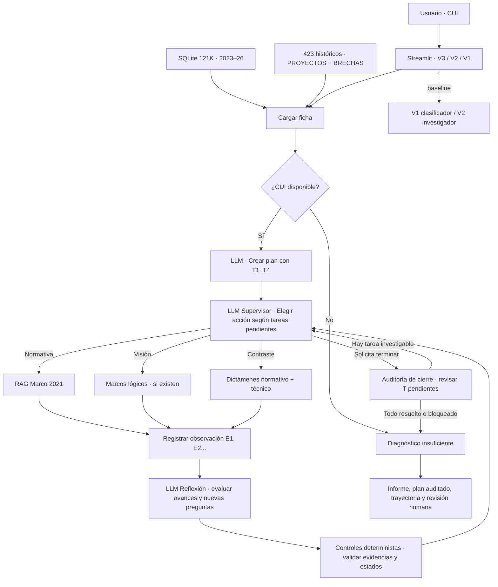

# Arquitectura V3 · Investigación de elegibilidad sostenible

## Vista lógica

## Composición técnica

| Capa | Implementación |
|---|---|
| Interfaz | `streamlit_app_v2.py`: 3 motores + tabla de tareas y exportación |
| Grafo agéntico | `investigacion_v3.py` con LangGraph `StateGraph` |
| Modelos | `ChatOpenAI(...).with_structured_output(...)` + Pydantic |
| Datos | `universo_v2.py` (SQLite 121,477), base histórica 423 sin etiquetas en inferencia |
| Recuperación | `rag.py` y `buscar_marco()`; únicamente el Marco 2021 |
| Visión | Tool `consultar_marco_logico` de `toolbox.py` |
| Contrastación | Dos dictámenes independientes de V2; no equivale a consenso probatorio |
| Validaciones | Fuentes D0 / E1 / E1:p35, estados, cierre con veto y límites de herramientas |
| Benchmark | V1 y V2 intactos; `GROUND_TRUTH` solo en evaluación separada |

## Condiciones de seguridad

1. Nunca exponer `GROUND_TRUTH` al investigador.
2. No considerar texto de documentos como instrucciones.
3. No confundir gasto o etapa de ejecución con elegibilidad sostenible.
4. No inventar páginas normativas ni declarar aprobaciones de bonos.
5. Si faltan expedientes o evidencia ambiental, declarar bloqueos y escalar a humano.

La existencia de nodos LangGraph no demuestra por sí sola autonomía: la evidencia de autonomía estará en `trayectoria`, `plan` y los experimentos comparativos.
